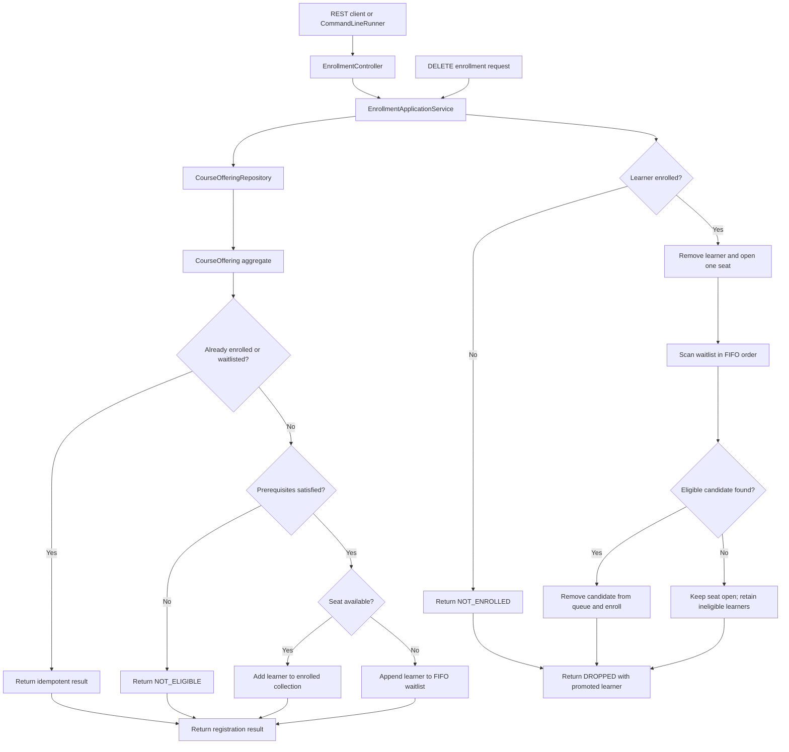

# Design specification

## Service boundary

The service manages enrollment, drop, and waitlist promotion for a single course-offering aggregate. The REST controller is an adapter; `EnrollmentApplicationService` coordinates use cases; `CourseOffering` protects domain invariants; the repository is an infrastructure port.

## Enrollment and drop flow

The aggregate performs each mutable operation under its `ReentrantLock`, so the state checks and resulting enrollment, queue, or promotion update are atomic for this in-memory implementation.

## API

- `POST /api/v1/course-offerings/{offeringId}/enrollments`
- `DELETE /api/v1/course-offerings/{offeringId}/enrollments/{learnerId}`
- `GET /api/v1/course-offerings/{offeringId}`

The enrollment request contains `learnerId` and `completedCourseIds`. This bounded design treats the caller as the source of learner-completion data; production integration with an identity or academic-record system is out of scope.

## Invariants

- Enrolled learners never exceed offering capacity.
- A learner may appear at most once across enrollment and waitlist collections.
- Only a learner satisfying all required prerequisites may enroll or be promoted.
- Waitlisted learners retain FIFO order, except that currently ineligible learners may be skipped during a promotion attempt.
- A failed or repeated drop does not change offering state.

## Waitlist policy

An eligible learner joins the waitlist only when capacity is full. If, at promotion time, an earlier waitlisted learner is no longer eligible, that learner remains in the waitlist and is skipped. The service continues in FIFO order to promote the earliest eligible learner. This preserves queue position and does not silently discard a learner.

## Concurrency and persistence

`CourseOffering` owns a `ReentrantLock`; enrollment, drop, and promotion run under the same lock. This makes the read-modify-write workflow atomic for the in-memory, single-process repository and prevents capacity oversubscription. The repository uses a `ConcurrentHashMap` for offering lookup.

The in-memory repository is deliberately non-durable. A production replacement would implement `CourseOfferingRepository` using a database transaction plus optimistic locking/versioning or a suitable pessimistic lock. The domain/application interfaces remain unchanged.

## Trade-offs and limitations

- State is reset on restart.
- There is no authentication, authorization, course catalog, persistence, waitlist cancellation, or multi-offering workflow.
- Submitted completion data is trusted for this assessment; a production service would resolve it from an authoritative academic-record service.
- The service uses a per-process lock only; it is not distributed-lock safe.
